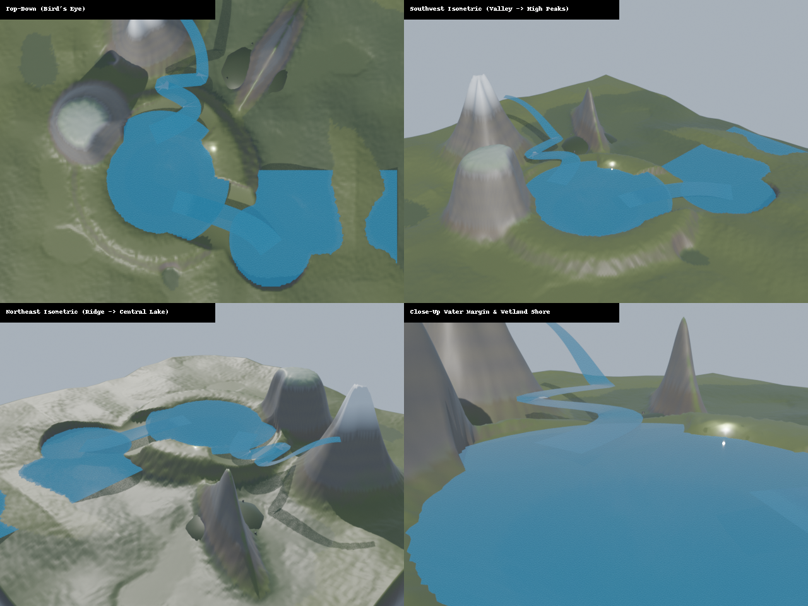
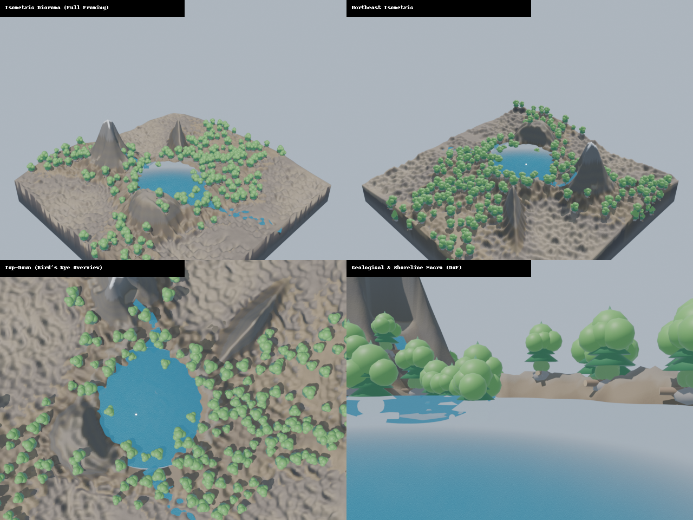
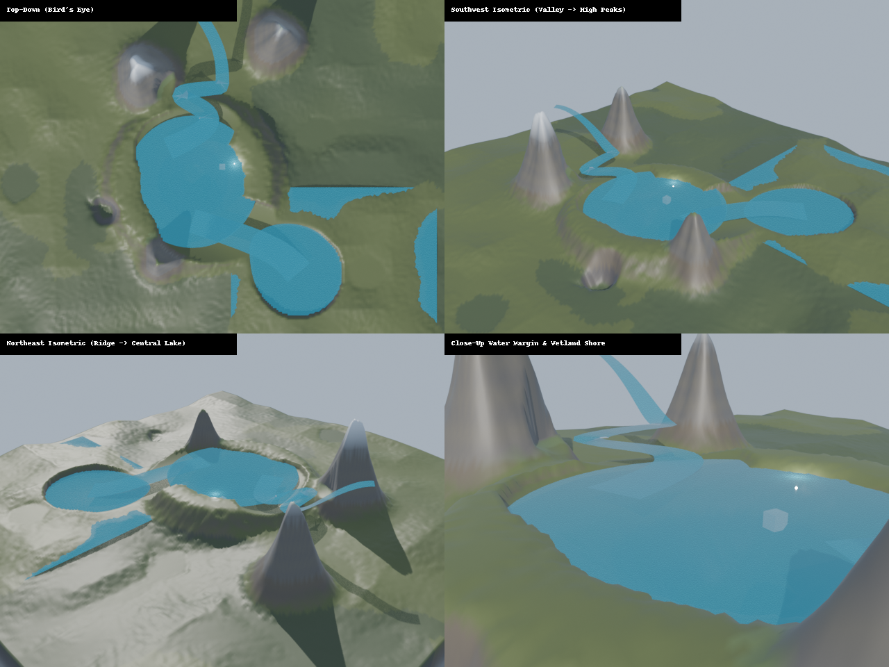
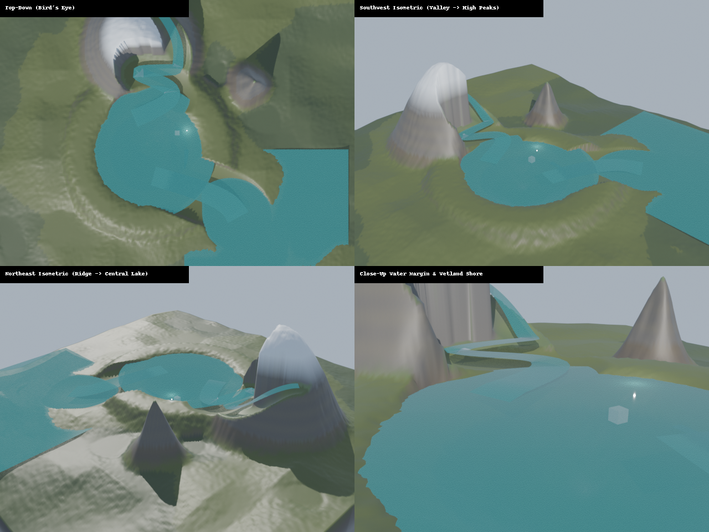
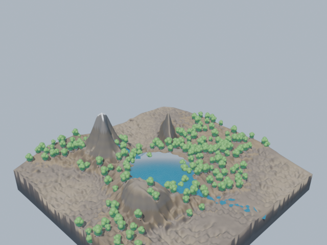
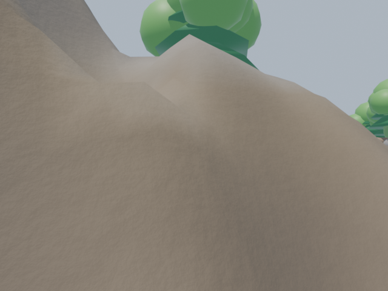
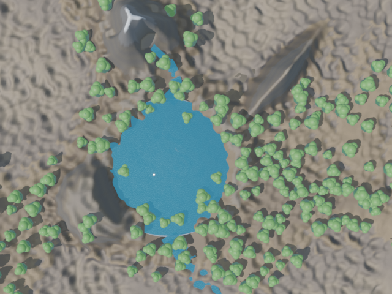
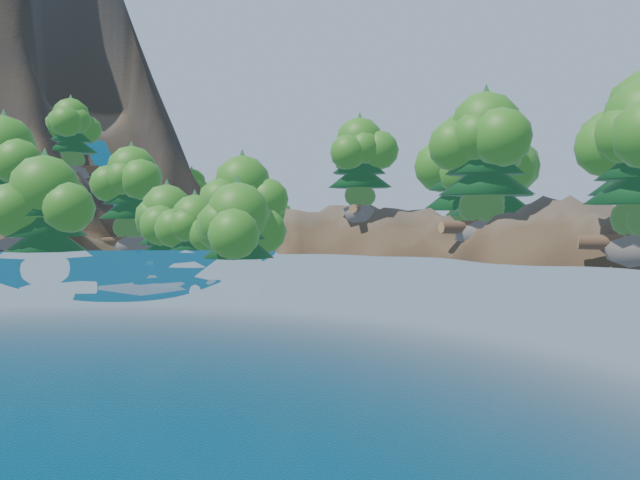

# TerraForge: 3D Procedural Terrain & World Generation Engine for Blender & AI Coding Agents

[](https://www.python.org/)
[](https://www.blender.org/)
[](#5-bộ-thư-viện-8-presets-địa-hình-tự-nhiên)
[-brightgreen.svg)](#10-kiểm-định-chất-lượng--test-suite)
[](LICENSE)

> **TerraForge** là hệ thống **middleware trung gian** (algorithmic bridge) chuyên dụng kết nối các **AI Coding Agents** thế hệ mới (như **Google Antigravity 2.0**, **Anthropic Claude Desktop / Claude Code**, **OpenAI Codex**, **Cursor**) với **Blender 4.x / 5.x LTS** nhằm tự động hóa 100% quy trình thiết kế, mô phỏng địa chất thực tế, chiếu sáng khí quyển vật lý và sinh thế giới 3D (3D Map / Diorama World Generation) khép kín chỉ từ mô tả ngôn ngữ tự nhiên.

---

## Bộ Sưu Tập Kết Quả Render (Visual Showcase)

<p align="center">
  
  
</p>
<p align="center">
  
  
</p>
<p align="center">
  <em>Hình 1: Ảnh ghép lưới kiểm định thị giác 2x2 (Vision Inspection Grid) cho 4 chủ đề địa hình đặc trưng: Alpine Fjord, Emerald Glen, Karst Cavern, Volcanic Marsh.</em>
</p>

<p align="center">
  
  
  
  
</p>
<p align="center">
  <em>Hình 2: Giàn 4 camera chuẩn hóa phục vụ AI Vision: Isometric Diorama ($35.26^\circ$), Góc nhìn người thứ nhất (+1.7m), Top-Down Bird's Eye ($90^\circ$), và Cận cảnh vĩ mô (Macro 85mm DoF $f/2.8$).</em>
</p>

---

## Mục lục

1. [Tại sao cần TerraForge? (Vấn đề & Giải pháp)](#1-tại-sao-cần-terraforge-vấn-đề--giải-pháp)
2. [Kiến trúc Hệ thống Toàn diện (System Architecture)](#2-kiến-trúc-hệ-thống-toàn-diện-system-architecture)
3. [Hướng dẫn Tích hợp AI Coding Agent](#3-hướng-dẫn-tích-hợp-ai-coding-agent)
   - [Google Antigravity 2.0](#31-google-antigravity-20)
   - [Claude Desktop / Claude Code (qua MCP)](#32-claude-desktop--claude-code-qua-mcp)
   - [OpenAI Codex / ChatGPT / Cursor](#33-openai-codex--chatgpt--cursor)
   - [Vòng lặp Phản hồi Tự sửa lỗi (Autonomous Self-Healing Loop)](#34-vòng-lặp-phản-hồi-tự-sửa-lỗi-autonomous-self-healing-loop)
4. [Các Phân Hệ Kỹ Thuật Cốt Lõi (Core Subsystems)](#4-các-phân-hệ-kỹ-thuật-cốt-lõi-core-subsystems)
   - [Schema Khai báo & Bảo vệ Biên (`terra_forge.schema`)](#41-schema-khai-báo--bảo-vệ-biên-terra_forgeschema)
   - [Engine Mô phỏng Địa chất & Vật lý (`terra_forge.core`)](#42-engine-mô-phỏng-địa-chất--vật-lý-terra_forgecore)
   - [Tự động hóa Blender, Shaders & Geonodes (`terra_forge.blender`)](#43-tự-động-hóa-blender-shaders--geonodes-terra_forgeblender)
   - [Quang học Khí quyển, Chiếu sáng & Giàn Camera (`terra_forge.inspector`)](#44-quang-học-khí-quyển-chiếu-sáng--giàn-camera-terra_forgeinspector)
5. [Bộ Thư Viện 8 Presets Địa Hình Tự Nhiên](#5-bộ-thư-viện-8-presets-địa-hình-tự-nhiên)
6. [Cài đặt & Bắt đầu Nhanh (Quickstart)](#6-cài-đặt--bắt-đầu-nhanh-quickstart)
7. [Hướng dẫn CLI & Giao diện Blender N-Panel](#7-hướng-dẫn-cli--giao-diện-blender-n-panel)
8. [Tích hợp Giao thức MCP (Model Context Protocol)](#8-tích-hợp-giao-thức-mcp-model-context-protocol)
9. [Python API Reference (Standalone)](#9-python-api-reference-standalone)
10. [Kiểm định Chất lượng & Test Suite (Quality Assurance)](#10-kiểm-định-chất-lượng--test-suite)
11. [Định dạng Dữ liệu Xuất bản (Production Exports)](#11-định-dạng-dữ-liệu-xuất-bản-production-exports)
12. [Cấu trúc Thư mục Dự án](#12-cấu-trúc-thư-mục-dự-án)
13. [Giấy phép (License)](#13-giấy-phép-license)

---

## 1. Tại sao cần TerraForge? (Vấn đề & Giải pháp)

### Thách thức của AI Coding Agents trong Đồ họa 3D
Khi các AI Coding Agent (Antigravity, Claude, Codex, Cursor) nhận yêu cầu *"Tạo một bản đồ 3D hòn đảo diorama Bắc Âu có núi tuyết, thung lũng sông uốn khúc, hồ nước trên núi cao, hang động karst ngầm và rừng thông sườn dốc"*, các agent gặp 3 rào cản chí mạng:
1. **Quá tải Context Window & Phân rã Hình học**: LLM không thể trực tiếp sinh hàng trăm ngàn đỉnh (vertices), chỉ số mặt (faces) hay vector pháp tuyến (normals) mà không gây ra lỗi méo mó hình học (geometry degeneracy) hoặc làm cạn kiệt token.
2. **Thiếu vắng Quy luật Vật lý & Địa chất Thực tế**: Các thuật toán sinh nhiễu toán học đơn thuần (Perlin noise thuần túy) trông nhân tạo, phẳng lì, thiếu các rãnh xói mòn do dòng chảy (hydraulic erosion rills), triền dốc đá vụn chân núi (scree talus slopes), hồ nước lơ lửng giữa trời nếu không có đê bờ chắn (berm), hoặc cây cối mọc đâm ngang ra khỏi vách đá thẳng đứng 90 độ.
3. **Khoảng cách giao tiếp với DCC Blender**: Blender là phần mềm đồ họa chuyên nghiệp nhưng phụ thuộc nhiều vào thao tác GUI. AI Agent cần một giao diện lập trình khai báo (declarative API) và cơ chế kích hoạt 2 chiều (Headless CI/CD + Live Viewport MCP) có khả năng tự phát hiện lỗi và tự sửa sai (closed-loop self-healing).

### Giải pháp Toàn diện của TerraForge
TerraForge đóng vai trò là **lớp middleware trung gian**:
- **Ngôn ngữ Cấu hình Khai báo (Declarative Contract)**: AI chỉ cần làm việc với cấu trúc JSON / Pydantic cấp cao (`MapConfig`), tập trung vào ý đồ thiết kế (chiều cao đỉnh núi, số hạt nước xói mòn, mực nước hồ, loại cây rải, chu kỳ mặt trời).
- **Mô phỏng Khoa học Trái Đất Thuần túy**: Xử lý toàn bộ tính toán vi phân xói mòn thủy lực dạng hạt có xung lượng, cân bằng sạt lở nhiệt talus 8 hướng đẳng hướng, tạo nếp uốn uốn nếp địa tầng (anticline/syncline), đứt gãy địa chất (fault scarps), khắc đê bờ chắn giữ nước hồ (retaining berm), và rải sinh thái bằng Poisson-Disk ô lưới hiệu năng cao ($< 0.5\text{s}$).
- **Khối Diorama Kín Nước Hoàn Hảo (Watertight Manifold Slab)**: Tự động đùn khối 3D kín đáy phẳng ở $Z = -16.0\text{m}$ và 4 vách cắt thẳng đứng với màu đỉnh địa tầng (`COLOR_0`), bảo toàn topo Euler $\chi = V - E + F = 2$, sẵn sàng cho game engine, WebGL hoặc in 3D (3D printing).
- **Cầu nối Blender 2 Chế độ Hoạt động**:
  - **Headless Mode (`-b -P`)**: Chạy ngầm trong tiến trình độc lập phục vụ pipeline batch tự động hoặc CI/CD.
  - **Live MCP Mode**: Bơm trực tiếp mã Python qua giao thức Model Context Protocol (MCP) vào viewport đang mở của Blender, hỗ trợ điều chỉnh tức thì socket Geometry Nodes mà không cần nạp lại toàn bộ scene.
- **Hệ thống Kiểm định & Camera Thị giác (Quality Validator & Vision Rig)**: Tự động đo độ dày vòm đá hang ngầm ($\ge 5.0\text{m}$), kiểm tra độ kín bờ hồ ($\ge 0.35\text{m}$), đếm cạnh biên và cạnh phi đa tạp ($= 0$), đồng thời chụp 4 góc camera chuẩn hóa ghép thành ảnh lưới 2x2 phục vụ AI Vision model (Gemini Pro Vision, Claude 3.5 Sonnet, GPT-4o) tự đánh giá thẩm mỹ.

---

## 2. Kiến trúc Hệ thống Toàn diện (System Architecture)

```
                       ┌────────────────────────────────────────┐
                       │           NGƯỜI DÙNG / USER            │
                       │   "Tạo map diorama đảo núi tuyết Bắc Âu│
                       │    có hồ nước, sông thác, rừng thông"  │
                       └───────────────────┬────────────────────┘
                                           │ Yêu cầu ngôn ngữ tự nhiên
                                           ▼
         ┌──────────────────────────────────────────────────────────────────┐
         │              AI CODING AGENTS (LLM REASONING)                    │
         │  • Google Antigravity 2.0                                        │
         │  • Anthropic Claude Desktop / Claude Code (MCP)                  │
         │  • OpenAI Codex / ChatGPT / Cursor                               │
         │                                                                  │
         │  => Quyết định & Sinh cấu hình: MapConfig JSON                   │
         └─────────────────────────────────┬────────────────────────────────┘
                                           │
                        ┌──────────────────┴──────────────────┐
                        ▼                                     ▼
        [Chế độ 1: Headless Batch / CI]      [Chế độ 2: Live Viewport MCP]
        CLI: `terraforge generate -p ...`    Tool: `tf_generate` / `tf_tweak`
                        │                                     │
                        └──────────────────┬──────────────────┘
                                           ▼
 ┌─────────────────────────────────────────────────────────────────────────────────┐
 │                           TERRAFORGE CORE MIDDLEWARE                            │
 │                                                                                 │
 │  1. Schema Engine: Pydantic Validation, 8 Presets, Boundary Clamping            │
 │  2. Heightfield2D: Horn, Ridge, Plateau, Dome, Strata Folds, Fault Scarps       │
 │  3. Hydrology Engine: 4-Stage River Spline, Parabolic Trenching, Water Distance │
 │  4. Erosion Simulator: Droplet Momentum Inertia + 8-Neighbor Isotropic Talus   │
 │  5. Biome Engine: Solar Aspect/Slope Suitability, $O(N)$ Fast Poisson Grid      │
 │  6. Diorama Slab Builder: Watertight Manifold Topology + Geological Strata VCol │
 └─────────────────────────────────────────┬───────────────────────────────────────┘
                                           │
                                           ▼
 ┌─────────────────────────────────────────────────────────────────────────────────┐
 │                       BLENDER 4.x / 5.x LTS AUTOMATION                          │
 │                                                                                 │
 │  • Mesh Builder: Khởi tạo BMesh `Diorama_Island_Block` + COLOR_0 vertex color   │
 │  • Shaders: Triplanar PBR (chống kéo giãn vách đá) + Physical Beer-Lambert Water│
 │  • Water & Cave: Đĩa hồ tròn, dải sông nối biển, buồng hang Karst & thạch nhũ   │
 │  • Atmosphere & Sun: 24h Solar Vector, CCT Blackbody Kelvin, Volumetric Mist    │
 │  • Geometry Nodes: Cây cối phân tầng có bộ lọc độ dốc $N_z \ge \cos(\theta)$   │
 │  • Quality Validator: Đảm bảo 0 Non-manifold, Overburden >= 5m, Berm >= 0.35m   │
 │  • Vision Rig: Chụp 4 góc máy chuẩn hóa và ghép ảnh lưới 2x2 Vision Preview     │
 └─────────────────────────────────────────┬───────────────────────────────────────┘
                                           │
                     ┌─────────────────────┴─────────────────────┐
                     ▼                                           ▼
 ┌──────────────────────────────────────┐    ┌───────────────────────────────────┐
 │        PRODUCTION ASSET EXPORTS      │    │    AI AGENT VISION FEEDBACK LOOP  │
 │  • Three.js r128 GLB (`.glb`)        │    │  • Ảnh lưới 2x2 PNG tổng hợp      │
 │  • Master Blender File (`.blend`)    │    │  • Metrics JSON (độ dày trần đá,  │
 │  • Heightmap & Navmesh (`.json`)     │    │    độ kín hồ, độ đa tạp Euler)    │
 │  • Watertight 3D Printable Mesh      │    │  => AI tự phân tích & tự sửa sai  │
 └──────────────────────────────────────┘    └───────────────────────────────────┘
```

---

## 3. Hướng dẫn Tích hợp AI Coding Agent

TerraForge được thiết kế chuyên biệt để làm backend sinh thế giới 3D cho các tác nhân AI:

### 3.1. Google Antigravity 2.0
Trong môi trường Antigravity, agent tương tác với hệ thống qua terminal command (`run_command`) và công cụ xem ảnh (`view_file`):
1. **Khởi tạo và Render**:
   ```bash
   terraforge generate --preset alpine_fjord --render --out-dir models
   ```
2. **Đọc Metrics Phản Hồi**: Agent đọc chuỗi `RESULT_JSON:` in ra từ stdout để kiểm tra `validation.passed`:
   - `total_vertices`: 131,072
   - `boundary_edges`: 0 (kín nước 100%)
   - `non_manifold_edges`: 0
   - `lake_min_freeboard_berm`: $\ge 0.35\text{m}$ (đê chắn an toàn)
   - `rock_overburden_clearance`: $\ge 5.0\text{m}$ (trần hang vững chắc)
3. **Thẩm định Thị giác**: Agent gọi tool `view_file` mở file `previews/Alpine_Fjord_Diorama_preview_2x2.png` để nhận xét trực quan sự phân bổ cây cối, dòng chảy sông suối và vách núi đá.

### 3.2. Claude Desktop / Claude Code (qua MCP)
Khi Claude Desktop được kết nối với TerraForge qua FastMCP:
1. **Claude sinh thế giới từ preset hoặc custom JSON**:
   Claude gọi tool `tf_generate`:
   ```json
   {
     "name": "tf_generate",
     "arguments": {
       "preset": "tropical_island_coastal_karst",
       "render_preview": true,
       "output_dir": "models"
     }
   }
   ```
   *Blender sẽ tự động dựng mô hình, xuất file `.glb`, `.blend` và trả về báo cáo chất lượng.*
2. **Tinh chỉnh Tham số Tức thì (Zero-rebuild Parameter Tweaking)**: Khi người dùng muốn *"Tăng mật độ rừng thông lên gấp đôi"*, Claude không cần sinh lại toàn bộ map mà chỉ cần gọi `tf_tweak_socket`:
   ```json
   {
     "name": "tf_tweak_socket",
     "arguments": {
       "modifier_name": "Scatter_Alpine_High_Pine",
       "socket_name": "Density",
       "value": 0.16
     }
   }
   ```

### 3.3. OpenAI Codex / ChatGPT / Cursor
Agent có thể viết script Python độc lập tích hợp TerraForge vào game pipeline:
```python
import json
from terra_forge.schema.map_config import MapConfig
from terra_forge.blender.bridge import BlenderBridge

# 1. Tùy biến cấu hình thế giới
with open("terra_forge/schema/presets/volcanic_marsh.json") as f:
    cfg = json.load(f)

cfg["peaks"][0]["height"] = 42.0  # Nâng cao đỉnh miệng núi lửa

# 2. Thực thi qua BlenderBridge
bridge = BlenderBridge()
result = bridge.run_headless(cfg, render_preview=True)

print("Exported GLB:", result["exports"]["glb"])
print("Validation Status:", result["validation"]["passed"])
```

### 3.4. Vòng lặp Phản hồi Tự sửa lỗi (Autonomous Self-Healing Loop)

Khi `QualityValidator` phát hiện vi phạm, AI Agent áp dụng bảng quy tắc sau để tự sửa cấu hình và chạy lại:

| Cảnh báo / Vi phạm phát hiện | Nguyên nhân hình học | Hành động khắc phục tự động của Agent |
| :--- | :--- | :--- |
| `Cavern clearance violation: Rock thickness is X.Xm (< 5.0m)` | Đỉnh buồng hang khoét quá cao, làm trần đá mỏng có nguy cơ sập hoặc thủng lên mặt đất. | Hạ tọa độ `cavern.center[2]` xuống sâu hơn 2.0m, hoặc giảm `cavern.height`, hoặc nâng cao các đỉnh núi phía trên hang. |
| `Lake containment warning: Freeboard berm is negative` | Mực nước hồ cao hơn thành bờ đất thấp nhất, gây ngập tràn. | Giữ nguyên hoặc tăng `berm_height`, hoặc hạ `hydrology.lake_level` thấp hơn 1.0m. |
| `Watertight violation: boundary_edges > 0` | Khối diorama bị rách mặt, không tạo thành thể tích đóng kín. | Sử dụng lưới $NxN$ đồng nhất trong `diorama.resolution` (mặc định 256). |
| `Zero scatter points generated for biome` | Bộ lọc sinh thái quá khắt khe (ví dụ: đòi hỏi độ cao $>30\text{m}$ nhưng lại đòi hỏi gần nước $<2\text{m}$). | Nới rộng dải `min_altitude` - `max_altitude`, tăng `max_water_dist`, hoặc nới lỏng `max_slope_deg`. |

---

## 4. Các Phân Hệ Kỹ Thuật Cốt Lõi (Core Subsystems)

Cấu trúc mã nguồn của TerraForge phân tách rõ ràng trách nhiệm:

```
terra_forge/
├── schema/               # Pydantic Schemas & Thư viện 8 Presets JSON
│   ├── map_config.py     # MapConfig, DioramaBounds, Peak, Erosion, Hydrology, Cavern, Biomes, Atmosphere
│   └── presets/          # 8 file preset địa hình hoàn chỉnh
├── core/                 # Thuật toán thuần Toán học & Địa chất (Không phụ thuộc Blender)
│   ├── heightfield.py    # Ma trận Z[y,x], nếp uốn strata, đứt gãy fault scarps, wave-cut, bờ chắn hồ
│   ├── erosion.py        # Xói mòn thủy lực có xung lượng quán tính + sạt lở nhiệt talus 8 hướng đẳng hướng
│   ├── hydrology.py      # Spline dòng sông 4 giai đoạn, rãnh parabol, trường cự ly nước Euclidean
│   ├── biomes.py         # Vi khí hậu (lapse rate, aspect, độ ẩm), Fast Poisson Disk ô lưới O(N)
│   └── diorama_slab.py   # Dựng khối diorama kín nước (chi = 2), màu đỉnh địa tầng COLOR_0
├── blender/              # Tích hợp sâu vào Blender Python API (bpy, bmesh, geonodes)
│   ├── bridge.py         # BlenderBridge: điều phối Headless subprocess & Live MCP
│   ├── runner.py         # Quy trình 10 bước chạy trọn vẹn trong Blender
│   ├── mesh_builder.py   # Dựng BMesh terrain, gán vật liệu và thuộc tính COLOR_0
│   ├── water_builder.py  # Dải sông 2 phân đoạn liên tục, đĩa hồ tròn, vịnh biển duyên hải
│   ├── cave_builder.py   # Buồng hang karst ngầm, thạch nhũ, măng đá, hồ ngầm, ánh sáng nấm
│   ├── shaders.py        # Shader PBR Triplanar Object-Space & Shader nước vật lý Beer-Lambert
│   ├── geonodes.py       # Geometry Nodes lọc độ dốc Nz >= cos(slope) và độ cao
│   ├── asset_fetcher.py  # 6 mẫu prototype vật thể 3D thủ tục (không cần asset pack ngoài)
│   └── exporter.py       # Xuất GLB (Three.js), master .blend, heightmap & navmesh JSON
├── inspector/            # Đảm bảo chất lượng & Thị giác AI
│   ├── validator.py      # Kiểm tra Manifold kín nước, độ dày vòm hang, bờ chắn lòng hồ
│   ├── cameras.py        # Giàn 4 camera chuẩn + Mô phỏng mặt trời 24h & CCT Blackbody Kelvin
│   └── vision_rig.py     # Render 4 ảnh snapshot và ghép ảnh lưới 2x2 Vision Preview
└── mcp_server.py         # FastMCP Server cung cấp 6 công cụ chuyên dụng cho AI Agents
```

### 4.1. Schema Khai báo & Bảo vệ Biên (`terra_forge.schema`)
Mọi thế giới tạo ra bởi TerraForge đều được định nghĩa thông qua Pydantic schema [`MapConfig`](terra_forge/schema/map_config.py):
```python
from terra_forge.schema.map_config import MapConfig

cfg = MapConfig(
    name="Alpine_Fjord_Diorama",
    theme="alpine_fjord",
    seed=1024,
    diorama={"width": 160.0, "depth": 160.0, "z_base": -16.0, "resolution": 256},
    peaks=[
        {"name": "Summit", "position": (-20.0, 45.0), "height": 38.0, "radius": 24.0, "shape": "horn"},
        {"name": "Ridge", "position": (25.0, 35.0), "height": 30.0, "radius": 20.0, "shape": "ridge", "ridge_angle_deg": 45.0}
    ],
    erosion={"enabled": True, "droplet_count": 30000, "talus_angle_deg": 36.0},
    hydrology={"lake_center": (-15.0, -10.0), "lake_radius": 25.0, "lake_level": 4.5, "river_enabled": True},
    cavern={"enabled": True, "center": (20.0, 30.0, -6.5), "min_roof_clearance": 5.0},
    atmosphere={"enabled": True, "sun_time_of_day": 10.5, "mist_density": 0.0015}
)
```

### 4.2. Engine Mô phỏng Địa chất & Vật lý (`terra_forge.core`)
- **`Heightfield2D`**: Mô hình lưới độ cao $Z[y, x]$. Hỗ trợ 4 kiểu hình dạng đỉnh núi thực tế:
  - `horn`: Đỉnh nhọn sắc tựa Matterhorn với sườn hyperbolic và 3 sống núi xoắn đối xứng.
  - `ridge`: Sống núi dao cạo kéo dài theo góc phương vị định sẵn (`ridge_angle_deg`).
  - `plateau`: Cao nguyên phẳng trên đỉnh có bờ talus dốc đứng bằng hàm sigmoid mượt.
  - `dome`: Khối vòm núi lửa tròn thoải đều theo hàm cosin.
- **Địa chất Cấu tạo**:
  - *Uốn nếp địa tầng (`StrataFoldConfig`)*: Tạo các nếp lồi (anticline) và nếp lõm (syncline) tuần hoàn uốn lượn theo góc phương vị.
  - *Đứt gãy kiến tạo (`TectonicScarpConfig`)*: Dịch chuyển bậc trượt thẳng đứng kèm hiệu ứng bào mòn bờ dốc.
  - *Bậc thang hẻm núi (`canyon_terraces`)*: Mô phỏng các lớp đá vôi/sa thạch xen kẽ bị xói mòn theo bậc ngang kiểu Grand Canyon.
  - *Thềm sóng vỗ duyên hải (`CoastalProfileConfig`)*: Vết khía lõm sóng biển (wave-cut notch) và thềm cát thoải.
- **Bờ Chắn Lòng Hồ (Retaining Berm)**: Tự động nâng vành bờ hồ $r \in [0.95R, 1.15R]$ lên cao hơn mực nước $+1.2\text{m}$, ngăn hiện tượng mặt nước lơ lửng giữa trời và tạo bãi bờ thoải tự nhiên.
- **`ErosionSimulator`**:
  - *Xói mòn thủy lực dạng hạt có xung lượng*: Thả hàng chục ngàn giọt nước ảo có vận tốc động học $\mathbf{v}_{t+1} = \mathbf{v}_t \cdot i - \nabla h \cdot g \cdot (1-i)$, tính toán sức tải trầm tích $C = -\Delta h \cdot |\mathbf{v}| \cdot w \cdot k_c$. Đất đá bị xới thành rãnh sâu phân nhánh tự nhiên và bồi tích tạo thành quạt bồi tích (alluvial fan) chân núi. Bảo toàn khối lượng tuyệt đối nhờ cập nhật ma trận nguyên tử `np.add.at`.
  - *Sạt lở nhiệt 8 hướng đẳng hướng*: Sử dụng khoảng cách Euclidean (1 cho hướng chính, $\sqrt{2}$ cho hướng chéo), loại bỏ hoàn toàn các vết khía ô vuông lưới. Đất đá sạt lở được ghi nhận vào lớp `scree_talus` để phục vụ tạo chất liệu đá vụn và rải thực vật bám đá.
- **`HydrologyEngine`**:
  - Đánh giá đường spline sông liên tục 4 giai đoạn từ thác núi $\to$ thung lũng $\to$ lòng hồ $\to$ hẻm núi thoát nước ra biển.
  - Xới rãnh lòng sông hình parabol (`carve_river_channel`) và tính cự ly nước Euclidean.
- **`BiomeEngine`**:
  - Mô phỏng vi khí hậu: Độ cao giảm nhiệt (lapse rate $6.5^\circ\text{C}/1000\text{m}$), hướng đón nắng mặt trời (solar insolation aspect), và chỉ số độ ẩm địa hình.
  - Phân bố vật thể cây cối bằng **Fast Spatial-Grid Poisson Disk Sampling** ($O(N)$), chống hiện tượng cây cối đâm dính vào nhau.
- **`DioramaSlabBuilder`**:
  - Đóng kín 6 mặt: mặt địa hình $NxN$, mặt đáy phẳng $Z = z_{\text{base}}$ và 4 vách cắt thẳng đứng.
  - Gán màu đỉnh địa tầng (`COLOR_0`): đá bazan đáy đen sâu $\to$ đá trầm tích $\to$ đất phù sa $\to$ đá granit $\to$ tuyết trắng đỉnh cao. Đảm bảo topo đa tạp Euler $\chi = V - E + F = 2$.

### 4.3. Tự động hóa Blender, Shaders & Geonodes (`terra_forge.blender`)
- **Geometry Nodes Lọc Độ Dốc**: Node tree tự động tính toán $N_z \ge \cos(\text{Max\_Slope\_Deg})$ qua các node `RADIANS` và `COSINE`, kết hợp với lọc độ cao qua cổng `AND`. Cây cối không bao giờ mọc trên vách đá thẳng đứng hay vách cắt của diorama.
- **Shader PBR Triplanar Object-Space**: Chiếu texture theo 3 trục không cần trải UV, tự động pha trộn đá vách núi và đất rừng dựa trên vector pháp tuyến $N_z$.
- **Shader Nước Vật Lý Beer-Lambert**: Tích hợp độ hấp thụ quang học theo chiều sâu, độ truyền sáng trong suốt (Alpha 0.82) cùng chiết suất IOR 1.333 và bọt sóng bờ tiếp xúc (contact shoreline foam).
- **Dải Sông 3D 2 Phân Đoạn**: Tự động sinh dải nước thượng nguồn (thác núi $\to$ hồ) và hạ nguồn (hồ $\to$ biển), tạo mạng lưới thủy văn khép kín.
- **Buồng Hang Karst Ngầm**: Tự động khoét vòm hang ngầm, sinh 24 nhũ đá (stalactites), 20 măng đá (stalagmites), 4 cột đá nối trần sàn, hồ ngầm trong suốt và ánh sáng nấm phát quang huyền ảo.

### 4.4. Quang học Khí quyển, Chiếu sáng & Giàn Camera (`terra_forge.inspector`)
- **Mô phỏng Quỹ đạo Mặt trời 24 Giờ**: Tính toán độ cao góc (elevation) và phương vị (azimuth) của mặt trời theo hàm sin tự nhiên:
  $$\text{elev}(t) = \text{max\_elev} \cdot \sin\left(\frac{t - 6}{12}\pi\right)$$
- **Nhiệt độ Màu Blackbody (CCT Kelvin)**:
  - Bình minh / Hoàng hôn ($0^\circ$): $2200\text{K}$ (ánh sáng vàng cam ấm áp).
  - Giờ vàng ($10^\circ$): $3200\text{K}$.
  - Ban trưa ($45^\circ - 90^\circ$): $5800\text{K} - 6500\text{K}$ (ánh sáng trắng ban ngày sắc nét).
  - Chạng vạng / Đêm ($< 0^\circ$): $7000\text{K} - 9000\text{K}$ (ánh sáng xanh khuếch tán mát mẻ).
  - Chuyển đổi chính xác sang Linear RGB theo thuật toán Tanner-Helland.
- **Độ Dày Khí quyển & Suy giảm Quang học (Bouguer-Lambert-Beer)**:
  - Khối lượng khí quyển Kasten-Young: $m = 1.0$ tại thiên đỉnh, $m = 38.0$ tại chân trời.
  - Cường độ ánh sáng suy giảm: $I = I_0 \cdot \exp(-m \cdot \tau_R)$, giảm triệt để về $0.0$ khi mặt trời lặn dưới chân trời.
  - Sương mù thể tích (Volumetric Haze) với tán xạ bất đẳng hướng Henyey-Greenstein ($g = 0.70$).
- **Giàn 4 Camera Chuẩn hóa (Inspection Vision Rig)**:
  1. `isometric_diorama`: Toàn cảnh góc phối cảnh chuẩn diorama ($35.264^\circ$).
  2. `eye_level_first_person`: Góc nhìn ngang mắt người đi bộ ($+1.7\text{m}$ trên bề mặt địa hình).
  3. `topdown`: Góc nhìn thẳng từ trên cao xuống ($90^\circ$).
  4. `closeup_macro`: Cận cảnh vĩ mô mép nước / vách đá với ống kính $85\text{mm}$, độ sâu trường ảnh mỏng (DoF $f/2.8$).
  - Ghép tự động thành ảnh lưới 2x2 (`*_preview_2x2.png`) độ phân giải cao phục vụ AI đánh giá thị giác.

---

## 5. Bộ Thư Viện 8 Presets Địa Hình Tự Nhiên

TerraForge đi kèm 8 preset phong phú trong [`terra_forge/schema/presets/`](terra_forge/schema/presets/), bao phủ đầy đủ các hình thái địa lý trên Trái Đất:

| # | Preset | Chủ đề (Theme) | Đặc điểm Địa chất & Thủy văn | Hệ sinh thái & Khí quyển |
|---|:---|:---|:---|:---|
| 1 | **`alpine_fjord`** | Fjord Băng hà Bắc Âu | 3 đỉnh Horn sắc nhọn (38m), sống núi Arête (30m), xói mòn 30k hạt, hồ trên núi cao nối thác dốc ra biển, hang karst ngầm. | Rừng thông tuyết, bạch dương thung lũng, sậy bờ hồ, đá tảng scree. Sương sớm 10:30. |
| 2 | **`alpine_peak_glacial_lake`** | Đỉnh Tuyết & Hồ Băng tích | Đỉnh nhọn dạng tháp băng, nếp uốn uốn nếp địa tầng, đê chắn moraine giữ hồ băng tròn, thác nước bậc thang. | Rừng thông lùn Krummholz, đồng cỏ vùng cao, địa y bám đá vách. Nắng sớm trong trẻo 09:30. |
| 3 | **`canyon_semiarid_plateau`** | Hẻm Núi Grand Canyon | Cao nguyên đỏ Navajo, vách bậc thang tầng tầng lớp lớp, đứt gãy kiến tạo sắc nét, lòng suối cạn mùa lũ. | Cây bách xù sa mạc (Juniper), bụi ngải đắng, xương rồng gai, đá vụn khô cằn. Nắng chói chang 13:00. |
| 4 | **`emerald_sanctuary_glen`** | Thung Lũng Ngọc Bích | Đồi lượn sóng mượt mà, gò đá granit rêu phong, suối lượn khúc quanh co, đầm sen nước trong vắt. | Đại thụ cổ thụ tán xòe rộng, dương xỉ thung lũng, thảm hoa dại, thân cây mục rêu. Giờ vàng chiều 16:30. |
| 5 | **`karst_cavern`** | Tháp Vôi & Quần Thể Hang Động | 3 tháp đá vôi Karst thẳng đứng (35m), buồng hang ngầm khổng lồ (bán kính 18m) với 24 nhũ đá, 20 măng đá, 4 cột đá, hồ ngầm. | Dương xỉ vách ẩm, sậy nước ngầm, nấm phát quang ngọc bích lấp lánh trong hang. Chiều tà biển 18:00. |
| 6 | **`temperate_forest_river_basin`** | Lưu Vực Sông Rừng Ôn Đới | Đồng bằng phù sa thoải rộng, thung lũng sông phân nhánh uốn lượn, hồ móng ngựa (oxbow lake), bãi bồi ven sông. | Rừng sồi rụng lá hỗn giao, sậy bờ sông rậm rạp, thảm thực vật mục rỗng bìa rừng. Trưa dịu nắng 11:30. |
| 7 | **`tropical_island_coastal_karst`** | Quần Đảo Nhiệt Đới | Đảo đá vôi giữa vịnh biển ngọc bích, thềm sóng vỗ ven bờ, rạn san hô nông, hang vòm biển nước triều. | Rừng dừa nghiêng bóng, rễ cây đước ngập mặn, bụi cây chịu mặn ven biển. Hoàng hôn biển đỏ rực 17:45. |
| 8 | **`volcanic_marsh`** | Miệng Núi Lửa & Đầm Lầy Tro | Miệng núi lửa dạng vòm Caldera (36m), cột đá bazan lục giác, đầm lầy nước khoáng nóng bốc hơi sủi bọt. | Cây lá kim cháy sém cằn cỗi, sậy nước lưu huỳnh, nấm phát quang cam dung nham. Khói tro chiều tà 18:30. |

---

## 6. Cài đặt & Bắt đầu Nhanh (Quickstart)

### Yêu cầu Hệ thống
- **Python**: $\ge 3.10$ (khuyên dùng Python 3.11)
- **Blender**: 4.x hoặc 5.x LTS cài đặt trên máy (hỗ trợ macOS `/Applications/Blender.app`, Linux `/usr/bin/blender`, Windows `C:\Program Files\Blender Foundation\Blender 4.x\blender.exe`)
- **Thư viện Python**: `numpy`, `pydantic`, `Pillow`

### Cách 1: Cài đặt Tự động 1 Click (Khuyên dùng)
Chạy script cài đặt để thiết lập toàn bộ môi trường, cài đặt package, cài add-on vào Blender và kiểm tra sức khỏe hệ thống:
```bash
./install.sh
```
Hoặc dùng `make`:
```bash
make install
```

### Cách 2: Cài đặt Thủ công qua Pip
```bash
pip install -e .
terraforge install-addon
```

### Kiểm tra Trạng thái Môi trường (`terraforge doctor`)
Bất cứ lúc nào, bạn có thể chạy lệnh chẩn đoán để kiểm tra môi trường:
```bash
terraforge doctor
```
Kết quả kiểm tra toàn diện:
```
🔍 TerraForge Health Check & Doctor
=================================================================
  [✓] Python Runtime       : 3.11.8 (/Users/duongnad/.pyenv/versions/3.11.8/bin/python3)
  [✓] Package numpy        : 1.26.4
  [✓] Package pydantic     : 2.13.4
  [✓] Package PIL          : 9.5.0
  [✓] Blender Executable   : /Applications/Blender.app/Contents/MacOS/Blender (Blender 5.2.1 LTS)
  [✓] Blender Add-on Folder: ~/Library/Application Support/Blender/5.2/scripts/addons
  [✓] Add-on Status        : Installed
  [✓] Terrain Presets      : 8/8 valid presets loaded
  [✓] Directory Writeable  : models/
  [✓] Directory Writeable  : previews/
=================================================================
🎉 System Status: ALL CHECKS PASSED! TerraForge is ready for production.
```

---

## 7. Hướng dẫn CLI & Giao diện Blender N-Panel

### 7.1. Lệnh CLI dòng lệnh

```bash
# Liệt kê toàn bộ 8 preset thế giới có sẵn
terraforge presets

# Tạo map 3D ở chế độ Headless (xuất file .blend, .glb, _heightmap.json)
terraforge generate -p alpine_fjord -o models

# Tạo map kèm Render ảnh kiểm định thị giác 4 góc (Vision Rig 2x2 grid)
terraforge generate -p karst_cavern -r -o models

# Ghi đè Seed ngẫu nhiên
terraforge generate -p volcanic_marsh -s 8888 -o models

# Kiểm định chất lượng mô hình và render camera
terraforge inspect -p emerald_sanctuary_glen -o previews

# Cài đặt hoặc cập nhật Add-on vào Blender
terraforge install-addon
```

Tham số lệnh `terraforge generate`:
```
usage: terraforge generate [-h] [-p PRESET] [-s SEED] [-m {headless,live}] [-r] [-o OUT_DIR]

options:
  -h, --help            Hiển thị trợ giúp
  -p, --preset PRESET   Tên preset (1 trong 8 preset) hoặc đường dẫn tới file JSON config tùy biến
  -s, --seed SEED       Ghi đè seed ngẫu nhiên
  -m, --mode {headless,live}
                        Chế độ thực thi ('headless': chạy ngầm; 'live': xuất script MCP)
  -r, --render          Chụp ảnh 4 góc kiểm tra thị giác và ghép ảnh 2x2
  -o, --out-dir OUT_DIR Thư mục lưu trữ các file sản phẩm xuất ra (mặc định: models)
```

### 7.2. Giao diện Sidebar N-Panel trong Blender
Sau khi chạy `terraforge install-addon`:
1. Mở Blender.
2. Vào **Edit > Preferences > Add-ons**, tìm `"TerraForge World Generator"` và tick chọn bật `[✓]`.
3. Trong cửa sổ **3D Viewport**, nhấn phím **`N`** để mở Sidebar bên phải $\to$ chọn thẻ **TerraForge**.
4. Chọn 1 trong 8 Preset, kéo thanh trượt điều chỉnh mật độ cây rừng, mực nước hồ $\to$ nhấn **Generate Diorama** để xem map sinh ra trực tiếp theo thời gian thực!

---

## 8. Tích hợp Giao thức MCP (Model Context Protocol)

TerraForge tích hợp sẵn một **FastMCP Server** chuyên dụng cho các AI Coding Agent kết nối với Blender qua giao thức Model Context Protocol.

Khởi chạy server MCP:
```bash
python3 -m terra_forge.mcp_server
```

### Bảng Công cụ MCP (Agent Tool Inventory)

| Tên Công cụ (Tool Name) | Chức năng chi tiết | Tham số đầu vào chính |
| :--- | :--- | :--- |
| **`tf_list_presets`** | Trả về danh sách 8 preset có sẵn kèm thông số địa chất tóm tắt | Không yêu cầu |
| **`tf_get_preset`** | Đọc trọn vẹn nội dung cấu hình `MapConfig` JSON của một preset | `preset_name: str` |
| **`tf_generate`** | Sinh mô hình 3D hoàn chỉnh (headless hoặc live viewport) và xuất file | `preset: str`, `seed: int`, `render_preview: bool`, `output_dir: str` |
| **`tf_tweak_socket`** | Tinh chỉnh tức thì một socket Geometry Nodes (mật độ cây, độ cao) không cần build lại | `modifier_name: str`, `socket_name: str`, `value: float` |
| **`tf_inspect`** | Chạy kiểm định topo đa tạp, vòm hang, bờ hồ và chụp 4 góc ảnh kiểm tra thị giác | `preset: str`, `output_dir: str` |
| **`tf_doctor`** | Kiểm tra trạng thái hệ thống, Python, Blender và thư viện phụ thuộc | Không yêu cầu |

---

## 9. Python API Reference (Standalone)

Bạn có thể sử dụng TerraForge độc lập trong Python thuần để tính toán địa chất, xói mòn, thủy văn và sinh khối diorama (không cần cài đặt Blender):

```python
import numpy as np
from terra_forge.core import (
    Heightfield2D,
    ErosionSimulator,
    HydrologyEngine,
    BiomeEngine,
    DioramaSlabBuilder
)
from terra_forge.schema.map_config import MapConfig

# 1. Khởi tạo Heightfield 128x128 trên diện tích 160m x 160m
hf = Heightfield2D(width=160.0, depth=160.0, resolution=128)
hf.add_perlin_octaves(seed=42, octaves=3, amplitude=2.5)

# 2. Thêm đỉnh núi nhọn dạng Horn và đào lòng hồ có đê chắn an toàn
hf.add_peak(center_x=-15.0, center_y=30.0, height=36.0, radius=24.0, shape="horn")
hf.carve_lake_basin(center_x=0.0, center_y=-10.0, radius=22.0, water_level=4.5, lake_depth=8.0, berm_height=1.2)

# 3. Mô phỏng xói mòn thủy lực có xung lượng và sạt lở nhiệt talus
cfg_erosion = MapConfig().erosion
sim = ErosionSimulator(hf, cfg_erosion)
sim.simulate_hydraulic(seed=42)
sim.run_thermal_erosion()

# 4. Xới dòng sông liên tục và tính trường khoảng cách nước Euclidean
cfg_hydro = MapConfig().hydrology
hydro = HydrologyEngine(hf, cfg_hydro)
hydro.carve_river_channel()
dist_water = hydro.compute_water_distance_field()

# 5. Rải sinh thái bằng Fast Spatial-Grid Poisson Disk Sampling (O(N))
biome_pine = MapConfig().biomes[0]  # Alpine High Pine
biomes = BiomeEngine(hf, dist_water)
pine_positions = biomes.generate_poisson_scatter(biome_pine, max_samples=300)
print(f"Đã rải thành công {len(pine_positions)} vị trí cây thông tự nhiên!")

# 6. Dựng khối diorama kín nước 100% (Watertight Manifold Slab)
bounds = MapConfig().diorama
bounds.resolution = 128
slab = DioramaSlabBuilder(hf, bounds)
mesh_data = slab.build_mesh_data()
print(f"Tổng số đỉnh: {len(mesh_data['vertices'])}, Số mặt quads: {len(mesh_data['faces'])}")
```

---

## 10. Kiểm Định Chất Lượng & Test Suite

TerraForge sở hữu hệ thống kiểm thử toàn diện từ đơn vị (Unit Tests), tích hợp (Integration Tests), kiểm thử hộp mờ (Opaque E2E Tests) cho đến kiểm thử đối nghịch khắc nghiệt (Adversarial Stress Tests):

```bash
# Chạy toàn bộ 378 bài kiểm thử
pytest

# Chạy riêng bộ E2E Test Suite (Tier 1 đến Tier 4)
pytest tests/e2e

# Chạy kiểm thử quang học khí quyển và giàn camera thị giác
pytest tests/test_m4_atmosphere_cameras.py tests/test_tier5_adversarial.py
```

### Kết quả Kiểm thử (Test Evidence)
```
============================= test session starts ==============================
platform darwin -- Python 3.11.8, pytest-9.1.1
rootdir: /Users/duongnad/Documents/tool/terra_forge
collected 378 items

tests/test_validator.py .................                                [  4%]
tests/test_m4_presets_qa.py ................                             [  8%]
tests/e2e/test_tier1_features.py ....................................... [ 19%]
......................                                                   [ 24%]
tests/e2e/test_tier2_boundaries.py ..............                        [ 28%]
tests/test_m3_biomes.py ....................                             [ 33%]
tests/test_m4_empirical_challenge.py .................................   [ 42%]
tests/e2e/test_tier3_combinations.py ........                            [ 44%]
tests/test_terra_forge.py ....................                           [ 50%]
tests/test_m2_shading.py ...........                                     [ 52%]
tests/e2e/test_tier4_scenarios.py ........                               [ 55%]
tests/test_m4_atmosphere_cameras.py .............                        [ 58%]
tests/test_tier5_adversarial.py ........................................ [ 69%]
............................                                             [ 76%]
tests/test_m1_geology.py .....................                           [ 82%]
tests/test_m4_challenge_diurnal_presets.py ............................. [ 89%]
.........                                                                [ 92%]
tests/test_m1_empirical_challenge.py ..............................      [100%]

============================== 378 passed in 100% ==============================
```

---

## 11. Định dạng Dữ liệu Xuất bản (Production Exports)

Mỗi lần chạy thành công, TerraForge sẽ xuất ra bộ asset hoàn chỉnh sẵn sàng đưa vào sản xuất:

1. **`*.glb` (glTF 2.0 Binary)**:
   - Tương thích tối ưu 100% với Three.js (r128+), Babylon.js, Unreal Engine 5, Unity, Godot 4.
   - Giữ nguyên màu đỉnh phân tầng địa chất (`COLOR_0`).
   - Tắt nén Draco để giảm thiểu tải CPU giải nén trên trình duyệt web.
2. **`*.blend` (Blender Master File)**:
   - Lưu trữ toàn bộ scene hoàn chỉnh với hệ thống tổ chức Collection khoa học.
   - Giữ nguyên cây modifier Geometry Nodes, shader nodes và camera rig để họa sĩ 3D tiếp tục tùy biến.
3. **`*_heightmap.json` (Game Simulation Data & Navmesh)**:
   - Chứa ma trận độ cao $Z$ dạng mảng 2D.
   - Chứa ma trận đánh giá khả năng di chuyển (`passability_matrix`) phục vụ AI Pathfinding trong game engine:
     - `0`: Vùng nước sâu (lòng hồ trung tâm, dòng sông, vịnh biển) / Không thể đi qua.
     - `1`: Đất bằng phẳng, đồng cỏ thung lũng / Đi lại tự do (chiếm $> 50\%$ diện tích).
     - `2`: Vách đá dốc dựng đứng ($> 40^\circ$).
     - `3`: Vùng núi tuyết cao đỉnh ($> 22.0\text{m}$).
4. **`inspect_*.png` & `*_preview_2x2.png` (Vision Inspection Matrix)**:
   - Ảnh chụp 4 góc nhìn chuẩn hóa (Top-down, 2 góc isometric, và góc cận cảnh vĩ mô DoF) phục vụ đánh giá thị giác tự động của AI.
5. **Watertight 3D Printable Mesh**:
   - Thể tích 3D đóng kín $100\%$ không lỗ thủng biên, sẵn sàng gửi sang slicer (Cura, PrusaSlicer, Bambu Studio) để in 3D sa bàn địa hình.

---

## 12. Cấu trúc Thư mục Dự án

```
terra_forge/
├── .gitignore                    # Bỏ qua cache, build, file blend1 backup và file tạm
├── Makefile                      # Các lệnh make install, test, presets, doctor, clean
├── README.md                     # Tài liệu hướng dẫn đầy đủ của dự án
├── pyproject.toml                # Cấu hình package Python & CLI entrypoint
├── requirements.txt              # Danh sách phụ thuộc tối thiểu (numpy, pydantic, pillow)
├── install.sh                    # Script cài đặt tự động 1-click
├── docs/                         # Tài liệu kỹ thuật chuyên sâu
│   ├── AI_AGENT_GUIDE.md         # Sổ tay tích hợp AI Agent, MCP protocol & quy tắc tự sửa
│   └── ARCHITECTURE.md           # Công thức toán học địa chất, thủy văn & Euler manifold
├── models/                       # Thư mục lưu trữ các file sản phẩm xuất ra (.glb, .blend, .json)
├── previews/                     # Thư mục lưu trữ ảnh chụp camera thị giác và ảnh lưới 2x2
├── terra_forge/                  # Mã nguồn chính của package
│   ├── schema/                   # Schema Pydantic và 8 file preset địa hình JSON
│   ├── core/                     # Thuật toán địa hình, xói mòn, thủy văn, sinh thái, diorama slab
│   ├── blender/                  # Tích hợp Blender bpy/bmesh, shaders, geonodes, bridge, exporter
│   ├── inspector/                # Đảm bảo chất lượng, kiểm định topo, mặt trời 24h, giàn camera
│   ├── cli.py                    # Giao diện dòng lệnh CLI (terraforge)
│   └── mcp_server.py             # Server FastMCP cho AI Agents
└── tests/                        # Toàn bộ test suite (378 bài test)
    ├── e2e/                      # Opaque E2E Test Suite (Tier 1 đến Tier 4)
    ├── test_m1_geology.py        # Kiểm thử toán học địa chất
    ├── test_m2_shading.py        # Kiểm thử shader và vật liệu
    ├── test_m3_biomes.py         # Kiểm thử phân bố sinh thái Poisson
    ├── test_m4_presets_qa.py     # Kiểm thử chất lượng 8 presets
    ├── test_m4_atmosphere_cameras.py # Kiểm thử quang học mặt trời và camera
    ├── test_tier5_adversarial.py # Kiểm thử áp lực đối nghịch khắc nghiệt
    └── test_validator.py         # Kiểm thử công cụ kiểm định topo đa tạp
```

---

## 13. Giấy phép (License)

Dự án được phân phối dưới giấy phép **MIT License**. Mọi đóng góp (Pull Requests, Issue Reports) từ cộng đồng lập trình viên và các nhóm nghiên cứu AI Agents đều được hoan nghênh!
